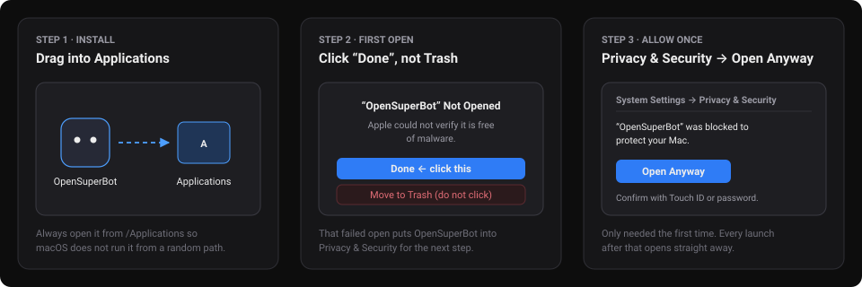

# The desktop app

The desktop app packs the gateway, the built web UI and the Node/Electron runtime into a single installer for macOS
and Linux, so running OpenSuperBot needs neither Node, pnpm, Docker nor a terminal. On first launch a short wizard
lets you pick a language, connect an AI service (or look around in demo mode with no key), and check what your
teammates' computer has to work with.

## Download

Pick the installer for your machine from the **[latest GitHub Release](https://github.com/wolfqing/OpenSuperBot/releases/latest)**:

| System | File | Notes |
|---|---|---|
| macOS (Apple silicon, M1–M4) | `OpenSuperBot-<version>-mac-arm64.dmg` | macOS 12 Monterey or newer |
| macOS (Intel) | `OpenSuperBot-<version>-mac-x64.dmg` | macOS 12 Monterey or newer |
| Ubuntu / Debian (x64) | `OpenSuperBot-<version>-linux-amd64.deb` | **Recommended on Ubuntu 24.04+** (installs `bubblewrap` and AppArmor profiles) |
| Ubuntu / Debian (ARM64) | `OpenSuperBot-<version>-linux-arm64.deb` | **Recommended on Ubuntu 24.04+** |
| Other Linux (x64) | `OpenSuperBot-<version>-linux-x86_64.AppImage` | Self-contained static runtime; needs no `libfuse2` |
| Other Linux (ARM64) | `OpenSuperBot-<version>-linux-arm64.AppImage` | Self-contained static runtime; needs no `libfuse2` |

Windows does not have a desktop installer in this release; run from source on Windows (see the
[README](../README.md#run-from-source) and [always-on.md](always-on.md)). Downloads come straight from GitHub
Releases, which can be slow in mainland China.

Every release includes `SHA256SUMS.txt`. To verify a download:

```bash
# macOS
shasum -a 256 --ignore-missing -c SHA256SUMS.txt

# Linux
sha256sum --ignore-missing -c SHA256SUMS.txt
```

## Opening the app on macOS (first time only)

The macOS app is ad-hoc signed, not notarized with an Apple Developer ID yet. Because Apple has not notarized it,
macOS blocks the very first launch until you confirm it in **System Settings**:



1. Open the `.dmg` and **drag OpenSuperBot into Applications**. Always launch it from `/Applications` — opening it
   straight from the disk image or `Downloads` makes macOS run it from a temporary randomized path (*App
   Translocation*), which breaks start-at-login.
2. Open **OpenSuperBot** from `/Applications`. macOS shows **“OpenSuperBot” Not Opened** — click **Done** (do
   **not** click *Move to Trash*).
3. Open **System Settings → Privacy & Security**, scroll down to the **Security** section, and click **Open Anyway**
   next to *“OpenSuperBot” was blocked to protect your Mac*, then confirm with Touch ID or your password.

After that one confirmation, OpenSuperBot opens normally every time.

## Installing on Linux

**Ubuntu and Debian (`.deb`, recommended):**

```bash
sudo apt install ./OpenSuperBot-<version>-linux-amd64.deb   # or -arm64.deb
```

Installing with `apt install ./…` pulls in `bubblewrap` and audio/GTK dependencies automatically and adds an
application menu entry plus `/usr/bin/opensuperbot`.

**Why Ubuntu 24.04+ should use the `.deb`:** Ubuntu 24.04 restricts unprivileged user namespaces under AppArmor by
default, which affects Electron's Chromium sandbox, downloaded browsers, and `bubblewrap` (the command sandbox).
The `.deb` installs `/etc/apparmor.d/opensuperbot` (and `/etc/apparmor.d/opensuperbot-bwrap` if your machine does
not already have a profile for `/usr/bin/bwrap`) so all three sandboxes stay on.

**AppImage:**

```bash
chmod +x OpenSuperBot-<version>-linux-x86_64.AppImage
./OpenSuperBot-<version>-linux-x86_64.AppImage
```

The AppImage uses the static AppImage runtime, so it does not require `libfuse2`. On Ubuntu 24.04+, an AppImage
cannot install AppArmor profiles on its own: if unprivileged user namespaces are blocked, OpenSuperBot **never**
falls back to `--no-sandbox` for teammate commands or browsers — instead, the commands switch stays locked and tells
you why. Prefer the `.deb` there, or install [`deploy/linux/bwrap.apparmor`](../deploy/linux/bwrap.apparmor) and
Google Chrome.

On Linux desktops without a system tray (such as stock GNOME without the AppIndicator extension), closing the
window still keeps OpenSuperBot running in the background; launch **OpenSuperBot** again from your app launcher to
bring the window back to the front.

## How the app behaves

- **Closing the window keeps it running.** Teammates keep working and scheduled routines keep firing. The menu bar
  icon (system tray on Linux) shows how many teammates are working and how many items wait on you, and the Dock
  badge counts what waits on you.
- **Notifications only for things waiting on you.** When the window is not focused, pending approvals, open
  questions and sign-in requests raise a system notification; clicking it opens that conversation.
- **Quitting asks first when work is running.** Choosing **Quit OpenSuperBot** from the menu bar or pressing `⌘Q`
  warns if a teammate is mid-turn or a routine is enabled, because nothing runs while the app is quit. System
  logouts and shutdowns quit cleanly without prompting so they are never held up.
- **Start at login is off until you turn it on**, on the last step of the setup wizard or in **Settings → Desktop
  app**. On macOS it registers a login item (falling back to `~/Library/LaunchAgents/io.github.wolfqing.opensuperbot.plist`
  when macOS declines an unnotarized bundle, while respecting your choice if you turned it off in *System Settings →
  General → Login Items*); on Linux it writes `~/.config/autostart/opensuperbot.desktop`.

## Update checks (one request, no auto-update)

Because the first release is not code-signed with a developer certificate, **the app never downloads or installs
updates automatically**.

When **Check for a newer version on startup** is enabled (the default), the app sends **one** HTTPS request when the
gateway starts:

```text
GET https://api.github.com/repos/wolfqing/OpenSuperBot/releases/latest
```

with `User-Agent: OpenSuperBot/<version>` and no machine or account identifiers. If a newer stable release exists,
**Settings → Desktop app** and the menu bar / tray menu show a link to the GitHub Release page so you can download
it yourself.

You can turn this off in **Settings → Desktop app**. When turned off, OpenSuperBot makes **zero** update-check
requests.

## Where your data lives

Everything the desktop app writes lives under one folder, kept as `OpenSuperBot` even if the display name changes
later:

| System | Folder |
|---|---|
| macOS | `~/Library/Application Support/OpenSuperBot` |
| Linux | `$XDG_DATA_HOME/OpenSuperBot` (default `~/.local/share/OpenSuperBot`) |

Inside that folder:

- `data/` — the gateway's data directory: SQLite database (`opensuperbot.db`), gateway sign-in token (`auth-token`),
  saved model API keys (`llm-key` and `llm-keys/`, mode `0600`), teammates' workspaces and browser profiles, shared
  skills, and any downloaded Chrome for Testing (`browsers/`).
- `session/` — the Electron window's own cookie and cache directory.
- `logs/gateway.log` — combined desktop and gateway log (with the gateway token redacted).
- `desktop.json` — the localhost port the app settled on (`4747` by default).

## Uninstalling cleanly

1. If you turned on **Open OpenSuperBot when I log in**, untick it in **Settings → Desktop app** first, then quit
   OpenSuperBot from the menu bar (`⌘Q` on macOS).
2. Remove the application:
   - **macOS:** move `/Applications/OpenSuperBot.app` to the Trash (and remove
     `~/Library/LaunchAgents/io.github.wolfqing.opensuperbot.plist` if present).
   - **Ubuntu / Debian (`.deb`):** `sudo apt remove opensuperbot` (this also unloads and removes the AppArmor
     profiles it installed).
   - **Linux AppImage:** delete the `.AppImage` file (and `~/.config/autostart/opensuperbot.desktop` if present).
3. Delete the single data folder above (`~/Library/Application Support/OpenSuperBot` on macOS, or
   `~/.local/share/OpenSuperBot` on Linux) to remove all conversations, browser profiles, keys and downloaded
   browsers. Nothing is left anywhere else.

## Using it alongside or migrating from a source checkout

The desktop app runs the exact same gateway and SQLite schema as `pnpm dev` / `pnpm start`:

- **Running both at once:** The desktop app listens on `127.0.0.1:4747` by default. If `4747` is already taken (for
  example by a gateway started from source), the app picks the next free port (`4748`, …) and remembers it in
  `desktop.json` so webhook URLs and SSH tunnels stay stable. **Settings → About** shows the active port.
- **Moving data from source to the desktop app (or back):** Quit both, then copy the contents of `gateway/data/`
  into the desktop app's `data/` subfolder (`~/Library/Application Support/OpenSuperBot/data` on macOS,
  `~/.local/share/OpenSuperBot/data` on Linux). Teammates, conversations, memories, routines and local browser
  profiles carry straight over.
